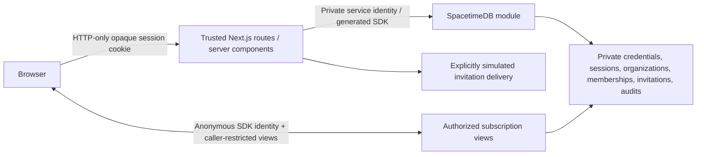

# AEGIS Phases 0–4 architecture

Two runtime services remain: Next.js (:3000) and a local SpacetimeDB TypeScript module (:3001). There is no extra API service, database, identity provider, corporate dependency or AI integration. This demonstrates independent trust boundaries in a hackathon environment, not production isolation.

## Authentication and command boundary

A private credentials table maps independent account names to synthetic profiles and salted scrypt hashes. Next.js looks up credentials using a separately provisioned SpacetimeDB service identity, verifies passwords with Node crypto, and creates random 256-bit opaque sessions. Only SHA-256 session hashes are stored in private SpacetimeDB sessions; the raw value travels in an HTTP-only, SameSite=Strict cookie (Secure in production). Sessions expire after eight hours. No app credentials or authenticated session tokens are persisted in browser localStorage.

The module declares `AEGIS_GATEWAY_IDENTITY` as publication configuration. Credential/session procedures and `access_command` reject every other caller. The application actor is derived from the validated session hash, never a client-provided user ID or role. Next.js checks request origin and Zod schemas; the database independently checks active/unexpired organization membership, incident membership and its central permission matrix for mutations and protected reads. Administrators manage access but do not inherently approve operations.

`access_command` applies authorized mutations transactionally. Expected denials commit a real audit event and a private command-result envelope; the server consumes the result and returns an appropriate HTTP error. Inputs must be validated before mutation. Unexpected exceptions escape and roll back the entire transaction. Result rows are removed after consumption or expiry. This avoids falsely acknowledging an operation or losing the denial audit through a thrown/rolled-back reducer.

Login history records success/failure, user when known, database timestamp, security event type and nonsecret event reference. Five failed attempts trigger a 15-minute account cooldown. This is an MVP control, not distributed production abuse protection.

## Real-time access lifecycle

1. Protected server pages validate the cookie/session and fresh membership/incident access before returning the workspace. Deep links preserve safe local return paths through login. Organization selection lists only current memberships and assignments.
2. The browser connects through the standard SDK React provider with an anonymous transport identity held in memory. Before binding, private tables remain unreadable and all access views are empty.
3. The browser posts its transport identity to a same-origin server endpoint. Next.js validates the HTTP-only session; the trusted reducer binds that identity to the session hash in a private connection-grant table. Binding a chosen public identity does not prove possession of that identity's SDK token or grant service privileges.
4. Views join caller identity → grant → session → active organization/incident memberships. `my_access`, `my_session`, `visible_members`, `visible_invitations` and `visible_audit` expose only authorized projections. Credentials and secret hashes are never returned to browser views.
5. Role changes, revocation and logout update the underlying dependencies. The SDK receives view deletions/updates; the frontend removes restricted content or updates permissions. Every subsequent server operation rechecks current database state.
6. A private scheduled reducer advances an expiry clock once per second, expires sessions/memberships, removes grants and records expiry events. Views depend on that clock, so time-based revocation works without another user action. Operation checks use actual transaction time immediately; view invalidation follows within one scheduler interval plus delivery latency. Logout removes all grants for that session. Transport grants remain scoped to the session lifetime, so a delayed disconnect cannot delete the grant of a reconnected SDK identity.
7. The frontend hides the workspace while disconnected and uses SDK reconnection. It binds from observed SDK state, including pooled connections reused during client navigation. It does not implement custom WebSockets.

Previously received data cannot be erased from a compromised device. The service token is privileged and must remain server-side. These are explicit prototype boundaries.

## Invitations, seeding and incident content

Invitations are recipient-bound and fix the organization, incident, role and one-hour expiry in the database. Raw 256-bit activation secrets are returned only to the authorized creator; only SHA-256 hashes are stored. Acceptance atomically checks status/expiry/recipient, grants memberships and consumes the token. Replacement revokes the old invitation. The last active organization administrator is protected from removal/demotion.

Existing synthetic responders authenticate with their independent passwords before accepting. A new phone recipient can enroll an independent account using a valid invitation; possession of the demo link is the enrollment proof. Administrator verification attestation and simulated link delivery are not carrier verification or MFA. The delivery interface supports a future provider adapter, but no Photon API contract is assumed and no SMS is falsely marked delivered.

The trusted, idempotent bootstrap creates Acme, six independent accounts, role associations, three invitation examples, minimal incident stubs and an audit event. A separate Northstar stub has no Acme memberships and demonstrates tenant isolation. User passwords are randomly generated in an ignored 0600 local file, not public endpoints or source. No unauthenticated administrator-creation path exists.

Phase 1 incident stubs remain for access compatibility. Phase 2 adds current incidents, findings, immutable events, evidence metadata/links and per-user read/visit/notification state. Overview, Scope and Timeline now read caller-scoped live data; purchasing approvals remain an explicit later-phase preview; Phase 4 implements conversations and coordination. The supplied references stay under `docs/design-references/`.

## Local workflow, configuration and deployment

The root npm workspace retains one lockfile. `scripts/dev.mjs` starts/reuses the local server, provisions a separate service identity, publishes with its configured identity, generates bindings and runs the trusted bootstrap before Next.js. The official CLI watcher handles backend changes. State and CLI/service credentials live under ignored `.spacetime/`. Publication preserves data and refuses destructive resets. Shutdown cleans up owned process groups and leaves reused servers running.

Public values in frontend `.env.local` configure canonical app origin and database endpoint/name. Root `.env.local` optionally configures scripts and private values. Shell values win, then root, then frontend values in script loading. Service secrets are inherited only by the trusted server process. Public Next.js values require a rebuild after deployment changes. `.env.production.example` documents independent HTTPS hosting; no hosting deployment is performed by setup.

Browser tests use 3100/3101, `.next-e2e`, `aegis-e2e` and separate state. Test-only expiry/restoration operations require both the service identity and `AEGIS_TEST_MODE=true`; no HTTP endpoint exposes them. Keep the database flag false outside isolated tests. The suite tests actual reducers/views, cookie sessions, private reads and cross-browser revocation; it does not substitute mock security success responses.

## Phase 2 records and file boundary

`incident-schema.ts` defines private tables; `incident-domain.ts` reuses the original authorization helpers rather than creating another identity system. `visible_incident_data` emits only authorized incident projections keyed by kind/ID. Every subscription joins the existing session/assignment/role checks. Evidence metadata and links additionally require evidence:view; randomized storage references are stripped. Notifications and finding reads are recipient/user scoped. Revocation empties projections and the outer workspace boundary removes restricted UI. Server mutations and file reads use actual transaction time, while subscription expiry follows the scheduled clock.

Authorized commands create incident assignments, findings, metadata and immutable change events in one database transaction. Incident and finding status are different enums; personal reads never change either. Human confirmation/resolution requires same-incident evidence and a verification justification. Notes/actions/decisions/corrections are classified events; recorded actions execute nothing. Administrative access changes append relevant incident events.

Next.js writes bounded, validated original evidence to an absolute private directory (`EVIDENCE_STORAGE_DIR`, local default `.spacetime/<state>/evidence`). Only metadata/hash/relationships enter SpacetimeDB. File reads use the trusted evidence descriptor procedure, fresh session/permission checks before and after I/O, hash verification, uncached safe responses and original-byte downloads. Browser text rendering escapes markup; image previews use authenticated bytes in disposable blob URLs. PDFs download. Filesystem and DB transactions are separate; known rejected commands remove new files; uncertain transport/commit outcomes preserve originals and can leave private orphans. This is local MVP storage, not a forensic custody, malware-scanning or production isolation service.

Visit windows capture the previous last-viewed timestamp before advancing it. A session-user/incident-scoped document UUID provides idempotence through client navigation. Reload creates a new visit. Separate finding read rows determine New; investigation status determines Unresolved. Notifications are private, delivered only to currently assigned active responders, and independently marked read. Reporter/assignee are the initial follower rule for evidence notifications.

The stable `acme-phase2-v1` fixture seeds three related scenarios, real synthetic originals and metadata, 9 findings, 26 immutable events and up to 8 initial notifications. It preserves current access, previously seeded/user-edited rows and new user work. Original-file UUID mappings stay private with the originals. The test-only ground truth is never imported into runtime code. A narrowly scoped reset clears only disposable IR-2043 read/visit state, requires explicit confirmation and a development-only module flag, and exposes no HTTP route. All destructive shared-data reset is intentionally absent.

## Phase 3 graph and record boundary

Seven private scope tables extend the module: shared organization inventory (`scope_entities`), incident associations, directed typed relationships, per-incident/per-entity/per-dimension current assessments, scope evidence annotations, minimal synthetic records, and explicit many-to-many record/group memberships. Inventory metadata models assets/datasets/groups without separate tables for every asset subtype. Existing Phase 2 incidents/findings/evidence are projected as graph nodes, never duplicated.

The browser receives `visible_scope_data` through the supported SDK React subscription. The view reuses caller → bound session → current organization/incident membership → permission checks. Only authorized incident inventory, relationships, assessments, evidence links and one record anchor are projected. Individual records require scope:records; the trusted `scope_read` procedure rechecks current transaction time and returns paginated records or one selected record. HTTP routes enforce session/origin/size checks; the module independently enforces permissions, endpoint ownership and evidence provenance. Role/revocation changes remove projections, and the outer workspace boundary hides protected content. Record-level event payloads are redacted for viewers without record permission.

`scope.*` actions use the existing trusted command reducer and denial-result envelope. All expected validation occurs before writes. A mutation updates current state, links existing Phase 2 evidence where selected and appends an incident event with actor/time/prior/new assessment and a scope-entity reference. There is no history edit/delete API. Follow-up findings call the existing Phase 2 implementation and add a relationship atomically. Evidence bytes, hash checking and authorized previews/downloads stay within the Phase 2 file boundary.

Pure deterministic traversal and counting live in `shared/scope.ts`. Traversal respects direction/type, skips ruled-out links, bounds expansion and preserves uncertainty. It emits leads without modifying assessments. Summary counting unions explicit record/group memberships and direct assessments, counts individual verification only at record level, and does not infer damage from dataset sizes or access paths. Encryption, exfiltration, alteration, deletion and availability remain independent. Unknown inventory counts remain unknown. Authorized summary-only roles receive aggregate counts without private record subscriptions.

React Flow renders a focused subset and supports selection, neighborhood expansion/collapse and filters. A separate paginated record dialog loads a selected record into the graph; the same data powers its detail panel. Scope events link back from Timeline. EV-018 resolves to its existing Phase 2 evidence ID and original authorized bytes. No additional service/database was added. Optional integrity comparison and Phase 5 workflows remain outside this implementation.

The `acme-phase3-v1` seed adds a stable synthetic inventory and 1,240 customer references with overlapping group memberships, bounded preliminary claims and zero initial individually verified affected records. Re-seeding can reconcile missing fixed fixture inventory associations, and never overwrites user actions, assessments or prior originals. The narrow IR-2043 read-state reset does not touch graph inventory. Source-repository test oracles are not application data or secrets from repository readers.

Reference: SpacetimeDB documents [private table access](https://spacetimedb.com/docs/tables/access-permissions/) and [subscribable read-only views](https://spacetimedb.com/docs/functions/views/). The implementation uses the installed 2.14.1 APIs and generated bindings.

## Phase 4 communication and paging boundary

`coord-schema.ts` adds twelve private tables: conversations, DM participant identifiers, messages, per-user conversation reads, tasks, append-only task updates, pages, manually declared responder availability, durable retry operations, notification targets, event visibility, and finding-source provenance. Message/task references are bounded validated structured JSON. Existing users, memberships, incidents, findings, original evidence, graph inventory, notifications and incident events remain authoritative. No additional runtime service or database is required.

`coord.*` actions use the existing trusted reducer/session/permission boundary. `/api/coordination` checks same origin, bounded bodies and the HTTP-only session, allowlists normal actions, and returns actual backend results. A per-actor/incident stable request UUID binds action/content to a durable result, so transport retries cannot duplicate successful work. Expected denials validate before mutation. `visible_coordination_data` uses the SDK React provider and caller-filtered subscriptions, rechecking current incident access. DMs add a two-participant restriction to existing membership; participant rows never grant access alone. Platform administrators have no implicit chat/task authority.

Conversions create actual shared Phase 2 findings or tasks with source-message provenance, retaining conversation visibility. Private-source restrictions propagate to task/finding references, events and recipient notifications. A transaction creating a finding filters its generated notifications before commit. Phase 2 projections filter derived findings, events, annotations and notifications; graph projections filter their virtual finding nodes. Broader graph associations of conversation-derived findings are rejected, preventing a private source from being broadcast through an assessment. Reference selection never copies EV-018 or Customer Database. Opening original evidence always goes through its existing freshly authorized file boundary.

Tasks model work separately from finding investigation and scope certainty. Assignment/due-date controls, assignee eligibility, transitions, independent review and evidence requirements are backend checks. Technical work cannot be reclassified as a coordination shortcut. Read state, message views, page acknowledgment and task verification cannot resolve a finding. Task notes and meaningful page transitions append existing incident events, with conversation visibility where needed; ordinary messages do not flood Timeline.

The existing persistent `access_timer` interval invokes the internal-only scheduled reducer once per second. After expiring access it processes pending pages using transaction time. Server policy selects a 300-second deadline (bounded development-only `AEGIS_PAGE_ACK_SECONDS` override). At deadline or target revocation, the transaction revalidates fallback access/availability, marks the original Escalated, creates one deterministic `original:backup` child and writes recipient notification/event. No eligible fallback produces an explicit cancellation instead. A terminal parent plus child key prevents duplicate ticks from generating extra pages. Backup pages do not cascade. Acknowledgment is restricted to the target before its deadline; task reassignment/completion/cancellation ends pending pages. All records and the scheduled interval survive standalone restart without republishing or a browser. Database downtime postpones delivery until restart; no production availability guarantee is claimed.

The client displays subscribed status/deadlines and persistent urgent banners; it never executes escalation from a JavaScript timer. Manual Available/Busy/Unavailable values describe responder intent, not online presence or authorization. There is no external pager, SMS transport or end-to-end encryption implementation. Deploy over HTTPS/WSS independently of the affected organization. Phase 5 recovery approvals/reporting remain deferred.
