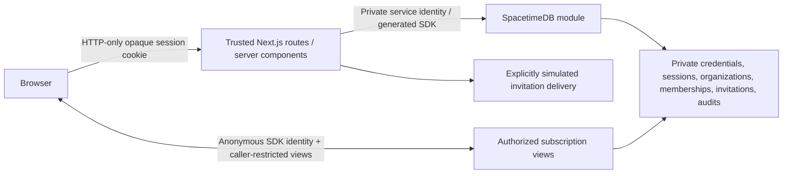

# AEGIS Phase 1 architecture

Two runtime services remain: Next.js (:3000) and a local SpacetimeDB TypeScript module (:3001). There is no extra API service, database, identity provider, corporate dependency or AI integration. This demonstrates independent trust boundaries in a hackathon environment, not production isolation.

## Authentication and command boundary

A private credentials table maps independent account names to synthetic profiles and salted scrypt hashes. Next.js looks up credentials using a separately provisioned SpacetimeDB service identity, verifies passwords with Node crypto, and creates random 256-bit opaque sessions. Only SHA-256 session hashes are stored in private SpacetimeDB sessions; the raw value travels in an HTTP-only, SameSite=Strict cookie (Secure in production). Sessions expire after eight hours. No app credentials or authenticated session tokens are persisted in browser localStorage.

The module declares `AEGIS_GATEWAY_IDENTITY` as publication configuration. Credential/session procedures and `access_command` reject every other caller. The application actor is derived from the validated session hash, never a client-provided user ID or role. Next.js checks request origin and Zod schemas; the database independently checks active/unexpired organization membership, incident membership and its central permission matrix for mutations and protected reads. Administrators manage access but do not inherently approve operations.

`access_command` applies authorized mutations transactionally. Expected denials commit a real audit event and a private command-result envelope; the server consumes the result and returns an appropriate HTTP error. Inputs must be validated before mutation. Unexpected exceptions escape and roll back the entire transaction. Result rows are removed after consumption or expiry. This avoids falsely acknowledging an operation or losing the denial audit through a thrown/rolled-back reducer.

Login history records success/failure, user when known, database timestamp, security event type and nonsecret event reference. Five failed attempts trigger a 15-minute account cooldown. This is an MVP control, not distributed production abuse protection.

## Real-time access lifecycle

1. Protected server pages validate the cookie/session and fresh membership/incident access before returning the workspace. Deep links preserve safe local return paths through login. Organization selection lists only current memberships and assignments.
2. The browser connects through the standard SDK React provider with an anonymous transport identity held in memory. Before binding, private tables remain unreadable and all access views are empty.
3. The browser posts its transport identity to a same-origin server endpoint. Next.js validates the HTTP-only session; the trusted reducer binds that identity to the session hash in a private connection-grant table. Binding a chosen public identity does not prove possession of that identity's SDK token or grant service privileges.
4. Views join caller identity → grant → session → active organization/incident memberships. `my_access`, `my_session`, `visible_members`, `visible_invitations` and `visible_audit` expose only authorized projections. Credentials and secret hashes are never returned to browser views.
5. Role changes, revocation and logout update the underlying dependencies. The SDK receives view deletions/updates; the frontend removes restricted content or updates permissions. Every subsequent server operation rechecks current database state.
6. A private scheduled reducer advances an expiry clock once per second, expires sessions/memberships, removes grants and records expiry events. Views depend on that clock, so time-based revocation works without another user action. Operation checks use actual transaction time immediately; view invalidation follows within one scheduler interval plus delivery latency. Logout removes all grants for that session. Transport grants remain scoped to the session lifetime, so a delayed disconnect cannot delete the grant of a reconnected SDK identity.
7. The frontend hides the workspace while disconnected and uses SDK reconnection. It binds from observed SDK state, including pooled connections reused during client navigation. It does not implement custom WebSockets.

Previously received data cannot be erased from a compromised device. The service token is privileged and must remain server-side. These are explicit prototype boundaries.

## Invitations, seeding and incident content

Invitations are recipient-bound and fix the organization, incident, role and one-hour expiry in the database. Raw 256-bit activation secrets are returned only to the authorized creator; only SHA-256 hashes are stored. Acceptance atomically checks status/expiry/recipient, grants memberships and consumes the token. Replacement revokes the old invitation. The last active organization administrator is protected from removal/demotion.

Existing synthetic responders authenticate with their independent passwords before accepting. A new phone recipient can enroll an independent account using a valid invitation; possession of the demo link is the enrollment proof. Administrator verification attestation and simulated link delivery are not carrier verification or MFA. The delivery interface supports a future provider adapter, but no Photon API contract is assumed and no SMS is falsely marked delivered.

The trusted, idempotent bootstrap creates Acme, six independent accounts, role associations, three invitation examples, minimal incident stubs and an audit event. A separate Northstar stub has no Acme memberships and demonstrates tenant isolation. User passwords are randomly generated in an ignored 0600 local file, not public endpoints or source. No unauthenticated administrator-creation path exists.

Only minimal incident stubs needed for access association are stored. The five screens use `frontend/lib/demo-incident.ts` for consistent fictional metrics, relationships, messages, requests and timeline events. They never drive actual authentication. Sensitive later-phase actions are disabled. The supplied screen references are retained under `docs/design-references/`.

## Local workflow, configuration and deployment

The root npm workspace retains one lockfile. `scripts/dev.mjs` starts/reuses the local server, provisions a separate service identity, publishes with its configured identity, generates bindings and runs the trusted bootstrap before Next.js. The official CLI watcher handles backend changes. State and CLI/service credentials live under ignored `.spacetime/`. Publication preserves data and refuses destructive resets. Shutdown cleans up owned process groups and leaves reused servers running.

Public values in frontend `.env.local` configure canonical app origin and database endpoint/name. Root `.env.local` optionally configures scripts and private values. Shell values win, then root, then frontend values in script loading. Service secrets are inherited only by the trusted server process. Public Next.js values require a rebuild after deployment changes. `.env.production.example` documents independent HTTPS hosting; no hosting deployment is performed by setup.

Browser tests use 3100/3101, `.next-e2e`, `aegis-e2e` and separate state. Test-only expiry/restoration operations require both the service identity and `AEGIS_TEST_MODE=true`; no HTTP endpoint exposes them. Keep the database flag false outside isolated tests. The suite tests actual reducers/views, cookie sessions, private reads and cross-browser revocation; it does not substitute mock security success responses.
